<p align="center"></p>

# CopperPilot Rugged Smartwatch

**A rugged 49 mm smartwatch around an ESP32-S3 module, with a 1.9-inch IPS screen under flat cover glass, a rotary crown, side and action buttons, an optical heart-rate sensor in a domed back and magnetic rear charging, on a standard 49 mm sport band. Designed end to end by CopperPilot from three photos and a short prompt.**

[](https://copperpilot.ai)  [](reviews/gates.md) [](reviews/kicad) [](reviews)  [](LICENSE)

> [!NOTE]
> **Designed by [CopperPilot](https://copperpilot.ai).** CopperPilot's agents designed every board, schematic, layout and enclosure part in this repo from one prompt and a few reference photos, then checked them with the gates and reviews below. Nobody edited the design files by hand. The prompt asked for a rugged smartwatch like the one in three photos, with the same bands, buttons, crown and display size, and heart-rate tracking, plus a short list of decisions (band type, rear charging, crown and button mechanics, bonded cover glass, domed back). The owner then asked for two review findings on the charging input to be fixed; the agents chose the parts, drew and routed the board, modelled the case and fixed every review finding themselves. **It has not been fabricated, assembled or powered on yet.** Everything here is open for review: if you see something a senior engineer would flag, [open an issue](../../issues/new/choose).

One 34 x 40 mm, 2-layer, 1.0 mm board with parts on both sides inside a 45 x 49 x 15 mm case:
- **Front:** a 1.9-inch 170 x 320 IPS panel (ST7789V2, SPI) under a flat cover glass bonded onto a ledge inside a
  1.8 mm raised rim.
- **Sides:** a rotary crown (a cap pressed onto a horizontal-shaft encoder through a sealed bore) and a side button
  on the right, an action button on the left; both buttons press side-actuated switches and clip in.
- **Back:** a domed, RF-transparent rear cover with an optical window over the MAX30102 heart-rate sensor and a
  2-pin magnetic pogo receptacle for the charging cable.
- **Band:** a bought 49 mm sport band slides sideways into lug channels at the top and bottom of the case.

## Status

### Done

- [x] Schematic: KiCad ERC, 0 errors
- [x] Layout: KiCad DRC with schematic parity and zone refill, 0 errors, 0 unconnected
- [x] Board rules no looser than the fab's limits, nothing silenced
- [x] Every part on the footprint and 3D model of its exact LCSC part
- [x] Every placed part has a live, in-stock LCSC/JLCPCB part number
- [x] High-speed groups (USB, MIPI, DDR where present) routed, length-matched, on target impedance
- [x] Every user-facing connector opens towards its case opening (checked on its 3D model)
- [x] Every connector mates from a known side, with a keep-clear zone KiCad DRC enforces
- [x] Both ends of every board-to-board cable carry the same signal on each wire
- [x] Datasheet-level design review: 0 P0 and 0 P1 findings open on every board
- [x] Enclosure parts are closed solids that fit the product envelope
- [x] Every enclosure part is manufacturable by its process (wall thickness, build size)
- [x] Full assembly with the real PCBAs: no collisions, seated or along any insertion path
- [x] Every cable joins two real connectors and fits its route in every pose
- [x] Every connector faces what mates with it; every screw hole sits on a boss
- [x] Every port opening has its connector right behind it
- [x] Every button and control physically reaches the switch it works
- [x] Every camera's whole field of view clears the case
- [x] Every part is held by something real (screw, snap, clip, adhesive, press fit)
- [x] Gerbers, drill, BOM and CPL exist and agree with the PCB
- [x] Independent judge (compares renders to the reference photos): **8/10** ([notes](reviews/judge.md))

### Pending

- [ ] Gate `sourcing.bom` warn: 32 extended parts (each adds a JLCPCB feeder fee); prefer basic parts where equivalent
- [ ] Gate `kicad.drc` warn: DRC warning silk_over_copper x23
- [ ] **Not built.** The board has not been fabricated or assembled and no case has been machined or printed.
- [ ] **No firmware.** The ESP32-S3 firmware (display, crown, buttons, heart rate, charging status) is not written or tested.
- [ ] **Bought parts are specified from drawings.** The 1.9-inch panel, the 220 mAh battery, the magnetic charging cable and the 49 mm band are modelled from typical listing drawings; exact suppliers still have to be chosen and checked against those models.
- [ ] **Judge notes (8/10):** the band lug channels are cut into flat end walls instead of blending into angled lug chamfers; the rectangular panel leaves a slightly wider black border than the reference display; the grille next to the action button is cosmetic (8 holes, no speaker on the board).
- [ ] **Water resistance not designed or tested.** The crown bore, button bores and bonded glass are sealed by design intent only; no gaskets are specified or rated.
- [ ] **DRC warnings:** 32 cosmetic warnings (silkscreen over copper or overlapping, and seven footprints that differ from their library copy); 0 errors.

0 P0 · 0 P1 · 0 P2 review findings open; the full reviews with evidence and suggested fixes are in [reviews/](reviews). Every P0 and P1 the reviews raised was fixed before release.

## Build film

[docs/build-film.mp4](docs/build-film.mp4) (48 s, 720p). Every part moves in the assembly order and along the insertion path that the collision gates checked, and every cable is drawn along its real route.

## Renders

| | |
|:---:|:---:|
| 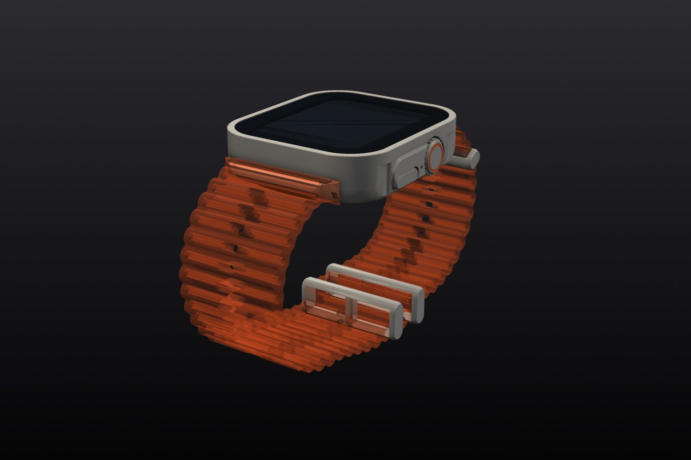<br>*Three-quarter view* | 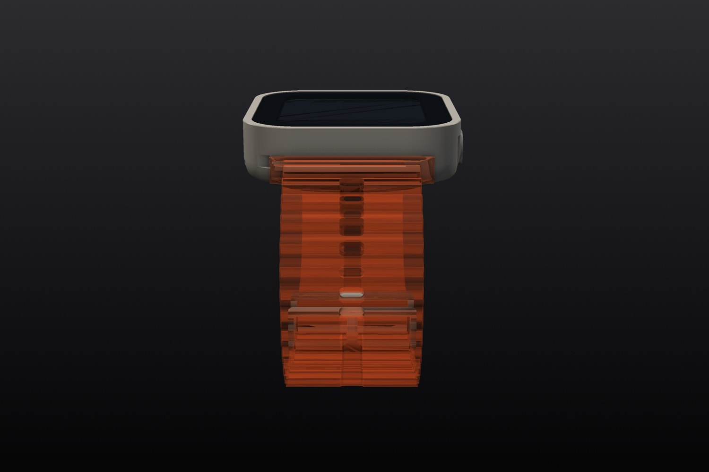<br>*Front* |
| 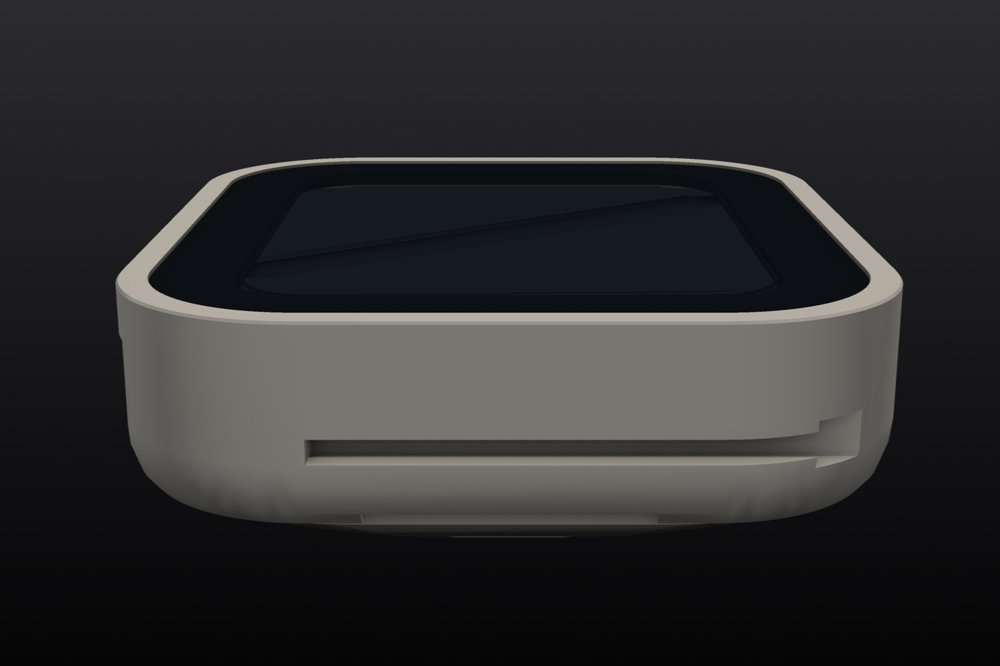<br>*Rear* | 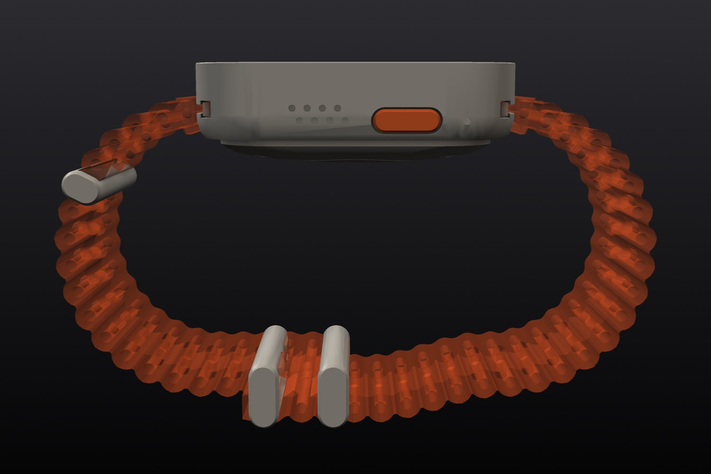<br>*Left side* |
| 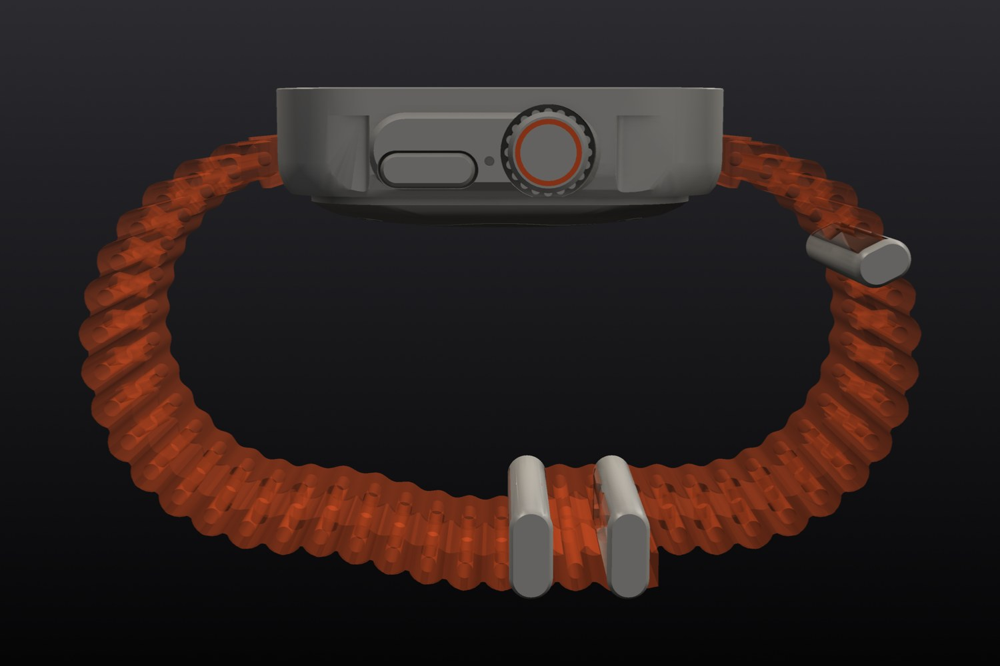<br>*Right side* | 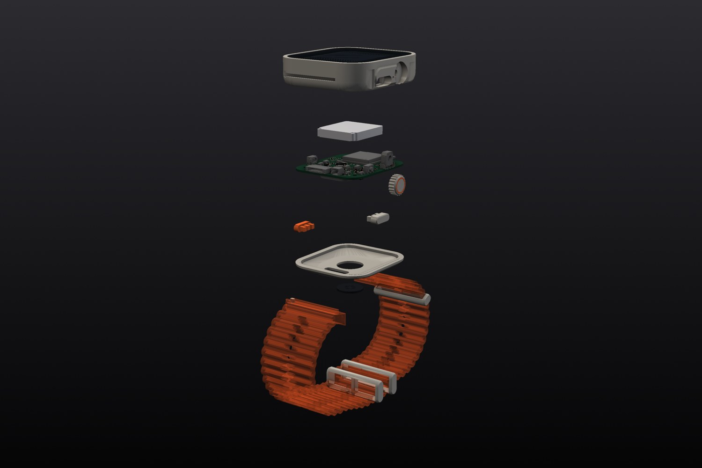<br>*Exploded* |
| 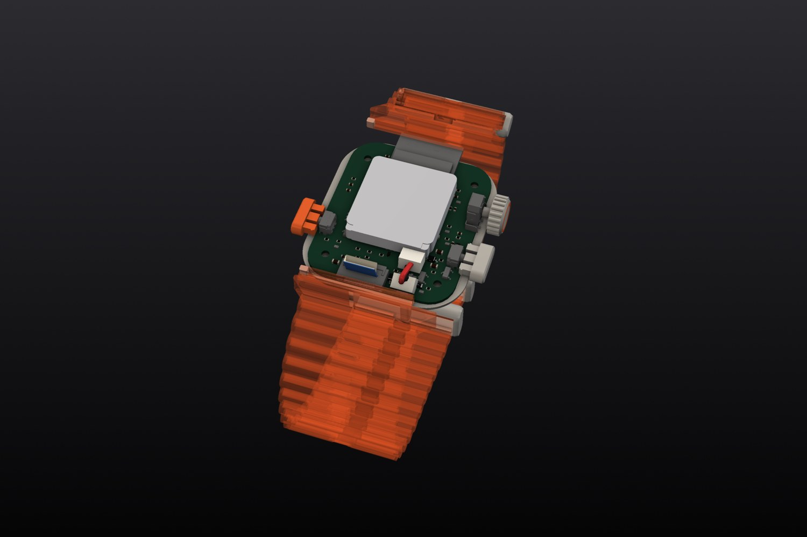<br>*Inside, top cover lifted away, every cable* | 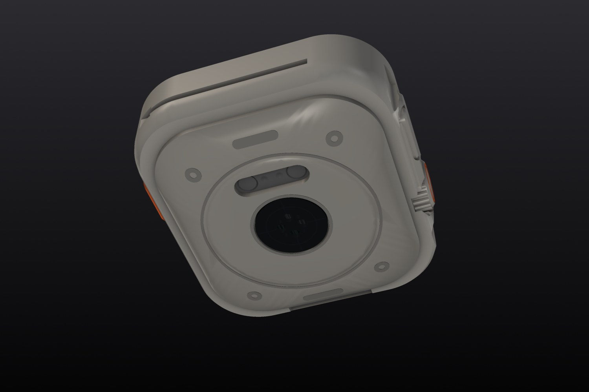<br>*Inside from below, bottom cover lifted away* |
| 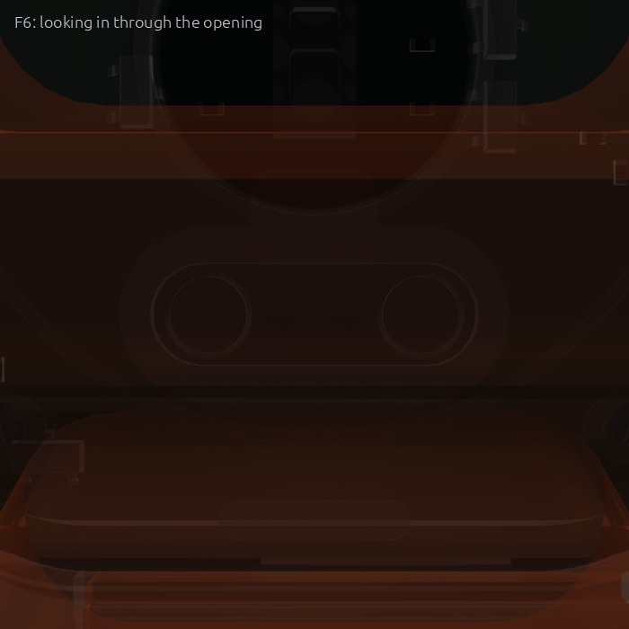<br>*Ports* | 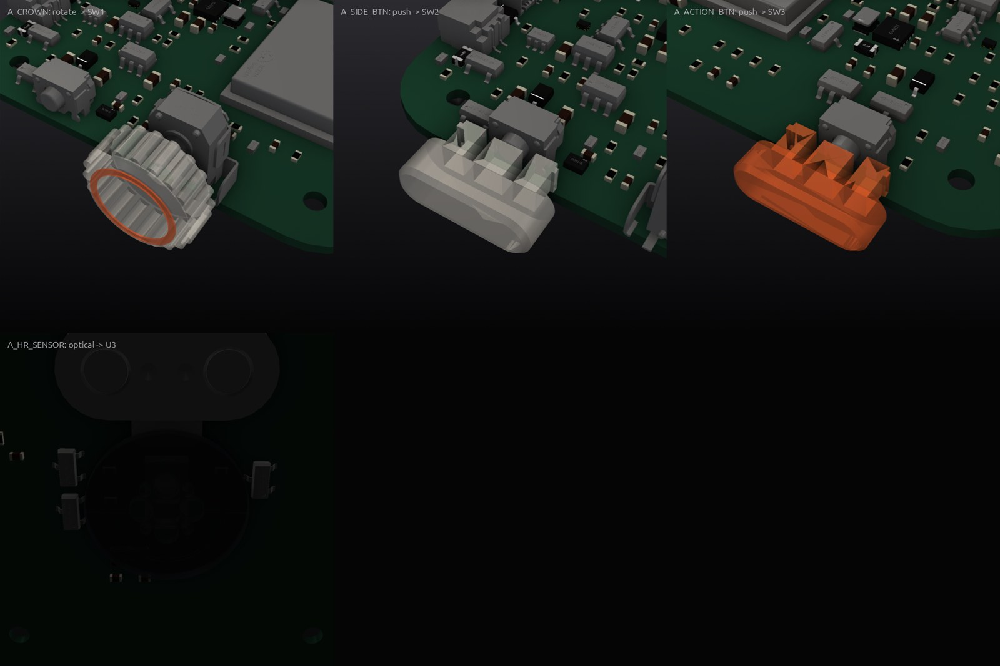<br>*Buttons and controls, next to the parts they press* |

## What's inside

**Brain:** ESP32-S3-MINI-1 (Wi-Fi + Bluetooth LE, 8 MB flash) with a 32.768 kHz RTC crystal; its antenna sits
behind the non-metal rear cover.
**Power path:** magnetic pogo input → TVS clamp → 0.5 A hold / 1.0 A trip resettable fuse → reverse-polarity P-FET →
36 V overvoltage switch (ETA7014) → 6.5 V-rated current-limited, reverse-blocking switch (TPS2553) → MCP73832
charger for a 220 mAh 1S LiPo, with load sharing to the system rail. A TPS63031 buck-boost makes 3.3 V, an LDO makes
1.8 V for the heart-rate sensor, and a two-channel driver dims the backlight. A push-button reset controller resets
the MCU when the side button is held.

| Board | Size | Layers | Parts | Tracks | Vias | KiCad project | Review |
|---|---|---|---|---|---|---|---|
| Main board | 34 × 40 mm | 2 | 120 | 1,522 | 151 | [`hardware/rugged-smartwatch.kicad_pro`](hardware/rugged-smartwatch.kicad_pro) | [0 P0 · 0 P1](reviews/review-main.md) |

**Bought parts** (modelled from their drawings; the assembly checks use these models):

- **Display panel**: 1.9-inch 170x320 IPS TFT LCD display module with ST7789V2 4-wire SPI interface and 12-pin 0.5 mm pitch FPC tail (separate LEDA/LEDK backlight pins)
- **Battery**: 3.7 V 220 mAh 1S LiPo pouch battery (352022) with integrated protection PCB and 2-pin 1.0 mm JST-SH lead
- **Display psa**: Die-cut perimeter acrylic pressure-sensitive adhesive gasket bonding front cover glass to case ledge

## How it was made

CopperPilot's agents worked from the prompt in [reference/prompt.md](reference/prompt.md) and 3 reference photos ([reference/](reference)). The pipeline scopes the product into a written contract ([design/spec.yaml](design/spec.yaml)), designs the boards and the enclosure in parallel, integrates them, and only moves on when the gates pass. A separate review agent reads every board against the part datasheets, and a separate judge compares the result with the photos.

- Pipeline wall clock: about **36 h** over 5 launches (pipeline v98 to v114).

**Reference vs build:**

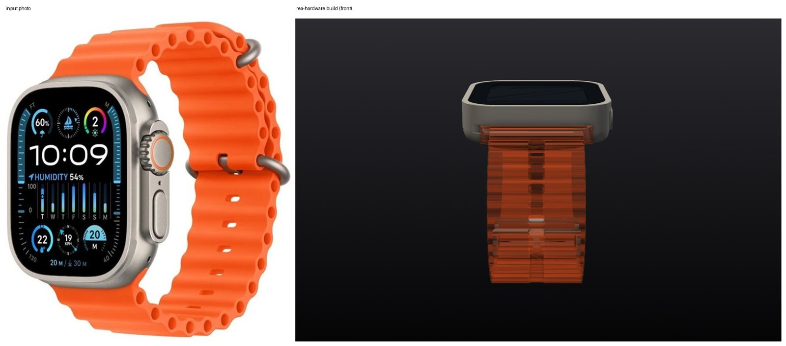
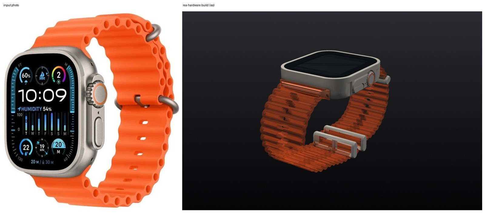
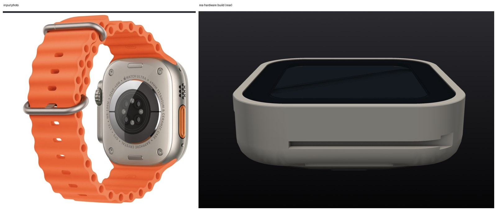

<sub>Reference photos of a commercial product, used here only for comparison. All rights belong to their owners; this project is not affiliated with or endorsed by the product's maker.</sub>

## Repository layout

```
hardware/          KiCad 10 projects (main board at the top, daughter boards in their own folders)
  lcsc.*, rea_refs.*   symbols, footprints and 3D models for every part, so the project opens anywhere
case/out/          enclosure parts (STL)
case/purchased/    bought parts used in the assembly checks
case/generate_case.py  the parametric enclosure source (uses CopperPilot's CAD helpers, not yet public)
fab/               Gerbers, drill, BOM, CPL, schematic PDF and STEP for each board; fab/mech/ enclosure STEP/STL
design/spec.yaml   the design contract the agents wrote and the gates check
reviews/           gate report, design reviews, the judge's notes, KiCad ERC/DRC
reference/         the prompt and the reference photos
docs/              build film and renders
```

## Manufacture

Every board targets **JLCPCB** standard PCB + assembly (1.0 mm FR-4); every part has an LCSC number. Per board: upload `*-gerbers.zip`, then `*-bom.csv` and `*-cpl.csv` for assembly, and check the part rotations in JLCPCB's preview before ordering.

The case body, crown cap, buttons and sensor window are designed for CNC (6061 aluminium, acrylic or sapphire for
the window), the rear cover for SLA in a ceramic-filled resin so the radio can see out; STEP files for each part are
in `fab/mech/`, with STLs for test prints. The board is set up for JLCPCB fabrication and two-sided assembly
(Gerbers, BOM and CPL).

> [!WARNING]
> This design has not been built yet. Fix or accept the open review findings above before you order boards, and expect a first revision to need changes.

## Review this design

Hardware gets better with more eyes on it. We'd like to hear what you'd flag:

- **Open an issue** ([design review template](../../issues/new/choose)) for a wrong pin, a missing part, a tight clearance, a part you'd swap, or a P1 above you disagree with.
- **Send a pull request** with a fix. Say which board and which reference designators it touches.
- **Build one** and tell us how it went: photos, bring-up notes and failures are all welcome.

Start with [reviews/](reviews): every finding has its evidence and a suggested fix.

## License

[CERN-OHL-S-2.0](LICENSE). You may use, study, modify, make and sell products from this design; modified versions must be shared under the same licence.

Part and product names are used only to say what fits; all trademarks belong to their owners.

<p align="center"><a href="https://copperpilot.ai"><b>Designed by CopperPilot</b></a>: we accelerate hardware design.<br><sub>More open designs: <a href="https://github.com/CopperPilot">github.com/CopperPilot</a></sub></p>
